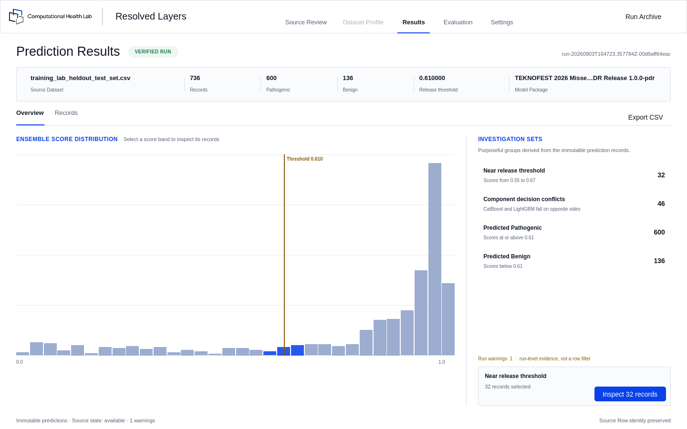

<div align="center">


# Resolved Layers

**A desktop application for model inference you can actually verify.**

[](LICENSE)
[](https://github.com/Abdourahman1909/resolved-layers/releases/latest)
[](#install)
[](https://doc.qt.io/qtforpython/)

</div>

---

Most model tooling asks you to trust a number. Resolved Layers is built the other
way round: every prediction stays connected to the exact row it came from, the
exact model that produced it, and the exact file you opened.

Its current workflow, **Variant Inference**, predicts missense-variant
pathogenicity. The application itself is not tied to that problem.

<div align="center">

</div>

## Why it exists

Running a model is easy. Defending the result is not.

When someone asks *"where did this number come from?"*, the usual answer is a
notebook and a hope that nothing changed since. Resolved Layers answers with
evidence: a checksummed source, a fixed model package, an immutable run, and a
record-level trail from any prediction back to the original row.

| | |
| --- | --- |
| **Nothing runs unreviewed** | You see the exact source, its SHA-256, and how it fits the model's contract, then confirm it explicitly before anything executes. |
| **Runs are immutable** | Each completed run is written once, with checksums over its own predictions. It cannot be edited into agreement with a later story. |
| **Evidence, not vibes** | Scores are model output, labelled as such. No prediction is presented as biological or clinical fact. |
| **Metrics require permission** | Accuracy is never guessed from a column that looks like labels. You choose the column, map the classes, and authorize it. |
| **Nothing is invented** | Where a value cannot be trusted, the application says so and withholds it, rather than showing something plausible. |

## Install

Download the latest **`Resolved_Layers-<version>-x86_64.AppImage`** from
[Releases](https://github.com/Abdourahman1909/resolved-layers/releases/latest),
then:

```bash
chmod +x Resolved_Layers-0.2.1-x86_64.AppImage
./Resolved_Layers-0.2.1-x86_64.AppImage
```

That is the whole installation. The file bundles its own Python runtime, Qt,
and model libraries, so nothing else is needed. Deleting it removes the
application completely.

> Download the **AppImage**, not the "Source code" archives that GitHub attaches
> automatically. Those contain this repository's code rather than a runnable
> application.

**Requires** Linux x86-64 with glibc 2.35 or newer (Ubuntu 22.04+, Fedora 36+).

### Add it to the applications menu

An AppImage runs on its own, but nothing registers it with the desktop, so
searching for it finds nothing. To get a proper menu entry and icon:

```bash
packaging/install-appimage.sh Resolved_Layers-0.2.1-x86_64.AppImage
```

It reads the icons out of the AppImage itself, so it needs no repository
checkout and no administrator rights. Remove the entry again with
`packaging/uninstall-appimage.sh`.

A wheel-based installer is also available for a launcher on `PATH` — see
[packaging/README.md](packaging/README.md).

## Model Packages

**The application ships without a model.** A Model Package is supplied
separately and installed once, from **Settings**.

That separation is deliberate. Loading a package deserializes model artifacts,
and deserialization executes code, so a package runs only when its exact
manifest SHA-256 is either recognised by the release or explicitly confirmed by
you. Loose model files and unpackaged folders are never accepted.

Everything that does not need the model works immediately: source review,
dataset profiling, and any runs already in the local archive, including their
records, evaluation, and export.

## What it does

**Review before you run.** Open a CSV and see its exact identity — filename,
dimensions, SHA-256, delimiter, encoding — beside a faithful read-only view of
the rows themselves. A transformation audit reports how the data will be aligned
to the model's contract. Nothing executes until you confirm.

**Understand the dataset first.** Dimensions, missingness, categorical group
breakdowns, and class composition, with filters that drill straight through to
the exact source rows behind any group.

**Run it once, immutably.** A verified run records ordered predictions with
checksums over the predictions themselves, plus the source, model package,
contract, threshold, and audit that produced them.

**Investigate the cohort.** The score distribution and the fixed release
threshold, with purposeful investigation sets — records near the threshold, and
records where the ensemble's components disagree. These are where a model is
least certain, and you can find them without any labels at all.

**Inspect single records.** Select any prediction and the complete original
source row opens beside it, recovered only while the source file remains
checksum-valid. If it changed, the application says so instead of showing stale
values.

**Evaluate, when you have truth.** Choose a ground-truth column, map its values,
authorize it, and get F1, precision, recall, MCC, accuracy and the confusion
counts — with the evaluated denominator and every excluded row disclosed. Error
cohorts carry straight into the records table.

**Export what you need.** Every original column beside the predictions, in
source-row order regardless of how you were sorting, with a traceability sidecar
recording exactly what produced the file.

## Development

Python 3.10 or newer.

```bash
python3 -m venv .venv
.venv/bin/pip install -e ".[dev]"
PYTEST_DISABLE_PLUGIN_AUTOLOAD=1 .venv/bin/python -m pytest
.venv/bin/resolved-layers
```

Build the standalone application with `packaging/build-standalone.sh`.

```text
src/variant_inference/
├── domain/          immutable product language and validation policy
├── application/     use cases and typed capability ports
├── infrastructure/  CSV, model package, and archive adapters
├── qt/              thin PySide6 presentation adapters
└── qml/             Qt Quick interface
```

The boundary is deliberate. CSV parsing, package validation, inference, archive
persistence, evaluation, and export each sit behind a separate port. QML parses
no data, deserializes no models, and calculates no metrics.

Architectural decisions are recorded in [docs/adr/](docs/adr/), product language
in [CONTEXT.md](CONTEXT.md), and project history in
[docs/PROJECT_MEMORY.md](docs/PROJECT_MEMORY.md).

## About Computational Health Lab

Computational Health Lab turns complex health data into transparent, testable
computational evidence.

We build tools where the reasoning is inspectable rather than asserted — because
a result nobody can check is not a result. Resolved Layers is our desktop
product for exactly that.

The lab's current variant-inference model was developed for the TEKNOFEST 2026
AI in Health competition, where we compete as a finalist. The competition is one
deployment context for this work, not its purpose.

## License

Released under the [MIT License](LICENSE). Copyright © 2026 Computational Health
Lab.

The distributed application bundles third-party components under their own
licenses, including Qt under the LGPL-3.0. See
[THIRD-PARTY-NOTICES.md](THIRD-PARTY-NOTICES.md).

Model packages, trained weights, and datasets are **not** covered by this
license and are not distributed with the application.
